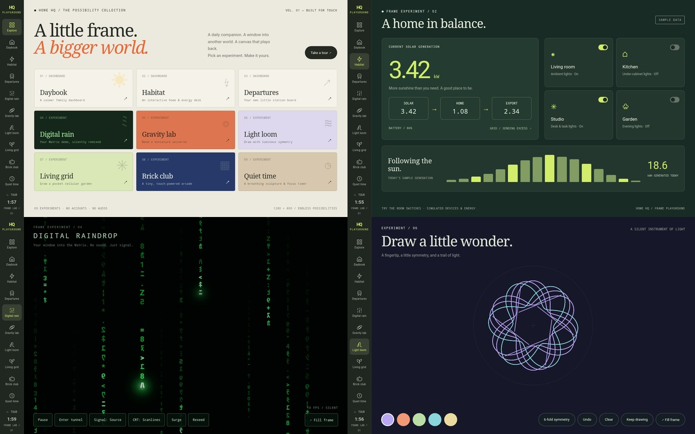

# Frame Playground

A temporary replacement for the Home HQ page collection on branch
`codex/frame-playground`. The original modules and styles remain in `js/views/`
and `css/views/`; the original shell is recoverable from the parent commit.
No Android package, firmware, launcher or accessibility changes are needed.



Run `npm ci`, `npm run build`, then `npm run preview -- --host 127.0.0.1 --port 4173`.
For development, use `npm run dev`. Built for the frame's 1280×800 display and
WebView 106. All fonts, graphics and rain assets are local; there are no API keys,
remote image dependencies, analytics, audio engines or account connections.

| Page | Try it |
| --- | --- |
| Explore | Open any experiment, or start a 25-second-per-page tour. Touch delays the next stop. |
| Daybook | Real local clock, sample weather and agenda; tap the household checkboxes. |
| Habitat | Toggle simulated room lights; home consumption and exported solar power change. |
| Departures | Change direction; simulated departures count down and loop every 24 minutes. |
| Digital rain | Touch ripples, rain/lite tunnel, four grades, flat/baked scanlines, surge, reseed, pause. |
| Gravity lab | Drag the attractor, switch to binary stars, pause or create a new field. |
| Light loom | Draw with 2/6/12-fold symmetry; change colour, undo, clear, or keep a drawing locally. |
| Living grid | Conway's Life on a wrapping grid. Paint/erase, step, randomise, or plant gliders. |
| Brick club | Touch/drag or arrow keys; Space/Launch starts. Three lives, 40 bricks, pause and restart. |
| Quiet time | 5/25/50-minute silent timer with breathing sculpture. Timer survives navigation/reload. |

The dashboards use conspicuously labelled fictional data. Room switches do not
control real hardware. The timer uses wall time; correcting the system clock can
change its remaining duration. Timers and kept drawings are stored only in this
browser's local storage, with a graceful session-only fallback.

Canvas experiments cancel their animation loop on navigation and skip work when
the document is hidden. The rain iframe is destroyed on navigation. The renderer
is limited to 10 updates/s (lite tunnel: 6); the other animated canvases to 15–30 FPS. Reduced-motion
preferences start rain, gravity and Life paused and stop decorative CSS animations.
Fill-frame mode retains an on-screen Menu exit; Escape also exits.

## Digital Raindrop adaptation

Adapted directly from the owner's supplied [Digital Raindrop](https://digital-raindrops.netlify.app/)
on 2026-10-15. `public/rain/rain.js` and `crt.js` preserve the supplied Canvas
renderer and original CRT implementation as unloaded references. The running
edition now uses a specialized fixed-grid, dirty-tile renderer in `frame-core.js`
and `frame-engine.js`. It has no audio engine or beat reactivity. It defaults to
flat display, caps its raster at 640 pixels wide, bakes scanlines into its atlas,
and leaves idle time between updates. The lite tunnel uses precomputed positions
and pre-sized glyphs, giving up camera flight and rotating text. Offscreen
pan/pinch territory is omitted. See [the performance notes](RAIN-PERFORMANCE.md)
for operation counts, memory bounds, device measurements and test commands. The original
rain source's UTF-8 SHA-256 was
`f11545d869e2a5e4d0048241f53ef7177bc55233b6718ac3155fb6462547c37e`.

## Temporary USB preview

With the existing Home HQ kiosk and its native escape controls intact:

```powershell
adb -d reverse tcp:4173 tcp:4173
adb -d shell am start -f 0x10008000 -a android.intent.action.VIEW -d 'http://127.0.0.1:4173/#explore' -n com.wesbos.homehq/.MainActivity
```

This VIEW URL is temporary; it does not replace the saved startup URL. Keep the
computer and USB connection available during the preview. To return to the hosted
dashboard without saving a new URL:

```powershell
adb -d shell am start -f 0x10008000 -a android.intent.action.VIEW -d 'https://home-dashboard.wesbos.workers.dev/' -n com.wesbos.homehq/.MainActivity
adb -d reverse --remove tcp:4173
```

The built site can also be served by any static host if a persistent demo is wanted.

The Android 6 Home alias can ignore a new VIEW intent while its task is active.
The commands above clear and reopen only the activity task so the new URL loads;
they do not force-stop the package or change its saved URL or accessibility grant.

## Verification on 2026-10-15

The initial demo checks below precede the eco rewrite. Current rain performance
checks and their limits are recorded in [RAIN-PERFORMANCE.md](RAIN-PERFORMANCE.md).

- Production build and syntax checks pass. The application entry bundle is about
  28 kB before gzip, excluding the separately loaded rain renderer.
- All nine pages rendered in the installed Home HQ 1.1.1 kiosk on the connected
  1280×800 AEEZO frame. No APK or system files were changed.
- Browser interaction checks covered the checklist, energy totals after switching
  lights, inbound/outbound departures, rain/tunnel/profile/display controls,
  fill-frame entry/exit, gravity modes, sketch drawing/storage, Life gliders and
  single steps, arcade launch/pause, and timer persistence across reloads.
- On-device touch input moved the gravity attractor, drew in Light loom, and
  launched Brick Club. The captured game reached score 10 after breaking a brick.
- The original CRT path ran poorly and its curved mode drew a blank image on this
  GPU. The initial frame edition therefore used CSS scanlines. A sample of that rain
  displayed 19 FPS and the simplified tunnel 7 FPS; these are observations, not
  guaranteed rates. The tunnel remains an experimental, slower option.
- The device is left on Explore with USB preview active. Its original hosted
  startup URL, default Home selection and navigation service are preserved.

Browser/ADB checks do not substitute for the owner's physical-panel check of the
native escape gesture. That existing escape path was not modified in this change.
