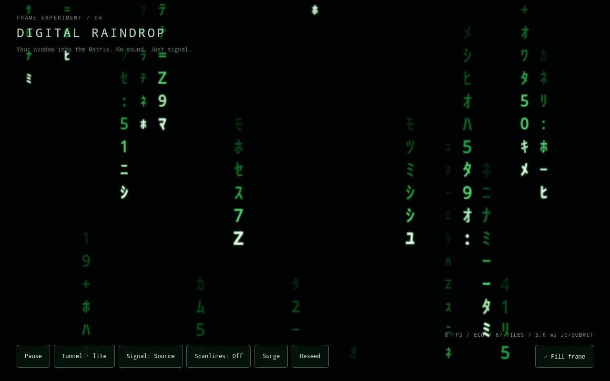

# Matrix rain on the A33 frame

The original frame adaptation could keep the AEEZO PF1009's A33 busy while
delivering only 8–10 FPS. A separate audit reported 85–88°C, cooling state 2/3,
and Home HQ using about 1.9 CPU cores. That audit found free RAM, little zram
use and no evidence of swap thrashing. More swap or a faster CPU governor would
not address the animation's unnecessary work.

The active page now uses `frame-core.js` and `frame-engine.js`. The supplied
`rain.js` and CRT implementations remain as **unloaded references**, including
for the repeatable command-count comparison. This is a specialized, simpler
renderer preserving the stationary code, independent stream speeds, bright
heads, colour profiles, touch ripples and surge effect.

## Where the work went

The reference does four broad kinds of work every drawn frame: stream/cell
updates, translucent bloom, all visible glyphs, and a full-raster vignette.
It rescales supersampled atlas sprites on every draw. Touch devices retain a
world 2.7 times wider than the viewport and still advance offscreen streams.
Per-cell objects, Maps, Map entry iteration/destructuring, pulse arrays and
temporary coordinate objects also create allocation/collection work. A 60 Hz
RAF callback keeps checking a 24 FPS deadline, even when raster throughput is
far below that target. A missed deadline leaves little room to idle.

The replacement changes the work rather than trying to increase the FPS:

- **Fixed cells and dirty tiles.** Only a changed glyph or quantized tone causes
  a copy. An unchanged cell costs no paint. The glyph tile includes an opaque
  background, so one copy also erases the previous glyph; no clear pass is needed.
- **No per-tick sprite scaling.** Glyphs are pre-rendered at the exact integer
  sizes used on the canvas, with the bright-head glow baked in. There are no
  per-frame gradients, glow buffers, filters or vignette overlays.
- **Baked scanlines.** Scanline mode rebuilds the atlas once. It adds no extra
  per-tick paint command or full-screen compositor layer. Flat is the default.
- **Bounded memory.** Only the visible field exists. Cell, lane, dirty-list and
  two-pulse state use reusable typed arrays, with no simulation objects or arrays
  created during a tick. Ripple distances are computed once per touch. Glyph
  mutation is limited to three cells every 200 ms.
- **Time and scheduling.** Rain is capped at 10 updates/s, rather than chasing
  24. Each update uses elapsed time, with a 250 ms stall clamp and no catch-up
  loop. The next timeout leaves room for both the frame cap and a 20% budget
  for measured simulation + Canvas submission work. There is only one RAF
  callback per scheduled update. Pause and document hiding cancel both timeout
  and RAF; they do not keep polling an inactive renderer.
- **Resolution.** The backing raster is capped at 640 pixels wide. The frame's
  1280×800 screen is unchanged. There is no DPR multiplier or offscreen pan/zoom
  world. Colour changes, resize and reseed may repaint the whole field once.

Tunnel mode has been removed at the owner's request; the running renderer and
controls now support rain only.

## Reproducible command-count comparison

From `dashboard/`:

```sh
npm run test:rain
npm run bench:rain
npm run build
```

The deterministic mock-Canvas comparison reports:

| Normal rain | Reference adaptation | Eco renderer |
| --- | ---: | ---: |
| Backing raster | 800×537 | 640×430 |
| Retained cells | 2,647 in sampled stream Maps | 544 fixed grid cells |
| Image copies per update, average | 254 | 62 |
| Scaled image copies per update | 239 | 0 |
| Full-raster clears per update | 1 | 0 |
| Nominal touched pixels per update | 1,056,456 | 29,760 |
| Nominal Canvas bitmap storage | 9.29 MiB | 3.07 MiB |
| New simulation buffers | — | 8,008 bytes |

The pixel estimate includes the reference's full-size vignette. It excludes
browser composition, framebuffer presentation and driver allocations. Bitmap
storage is width×height×4, not measured GPU memory, RSS or PSS. The simulations
and visuals differ; these counts establish bounded work, not an FPS prediction.
The new smaller atlas is reused on palette changes instead of retaining
an atlas for every configuration.



## Brief device observations, 2026-10-15

Four samples ran in the existing Home HQ 1.1.1 kiosk with WebView 106 and its
Mali-400 GPU. Each sampled about 6.6 seconds, read temperature about once a
second, and returned to Explore. They would have stopped at a reported 70°C;
no limit was reached. No APK, thermal controls, governor, swap or Android
settings were changed.

| Page | Home HQ CPU, one-core scale | Observed update counter | Reported temperature during sample |
| --- | ---: | ---: | ---: |
| Explore idle | 0.8% | — | 44–50°C |
| Eco rain, flat | 3.1% | 8 FPS | 48–52°C |
| Eco rain, scanlines | 3.5% | 8 FPS | 50–53°C |
| Tunnel · lite | 7.1% | 6 FPS | 49–54°C |

Cooling state remained 0 throughout. CPU was calculated from deltas in the
process's utime+stime and `/proc/stat`, normalized to one core: 100% is one
fully occupied core. This is a different observation window/method from the
older audit's `dumpsys cpuinfo` snapshot, not a controlled long-duration A/B test.
The direct-page test raster was 640×400; the normal sidebar page is 640×430.

The diagnostic HUD sampled about 3.6 ms simulation + submission for flat rain,
5.1 ms for scanlines. The former lite-tunnel measurement above is historical;
that mode has now been removed. These timings exclude
deferred GPU/raster/compositor work. The FPS counter counts submitted updates,
not hardware presentation. A short cool-device test does **not** establish a
five-minute equilibrium temperature or predict behavior in a different enclosure.

For a bounded diagnostic run, open `/rain/index.html?diag&bench` in the kiosk.
It pauses automatically after 80 timed updates. Add `&scan=1` for scanlines. Diagnostics retain one scalar snapshot, not
a growing trace. Normal demo navigation does not enable this benchmark mode.

Ten automated tests cover dirty-tile correctness, stable buffer identities
through 10,000 ticks, pulse expiry, elapsed-time motion, dirty-cell fraction,
duty scheduling, pause/visibility
cancellation, repeated reseeding and palette changes, cleanup, invalid options and benchmark stop.

General Canvas guidance supporting the atlas/integer-coordinate approach:
[MDN: Optimizing canvas](https://developer.mozilla.org/en-US/docs/Web/API/Canvas_API/Tutorial/Optimizing_canvas).

## Follow-up on the owner's five-minute scanline run

The owner reported running scanline rain for five minutes. An additional read-only
11.06-second sample, without reloading or changing that view, found:

- Reported chip temperature: initially 56°C, then 57°C for the remaining readings.
- Thermal cooling state: 0 throughout.
- Home HQ CPU: 61.31% on the one-core scale; whole-system CPU: 39.37% across all cores.
- Screenshot counter: 9 FPS, scanlines enabled, in Home HQ's fill-frame view.
- Home HQ PSS: 136919 KiB (about 133.7 MiB).

This longer-run CPU figure supersedes treating the earlier 3–4% short sample as
representative of normal use. The earlier samples opened the rain page directly;
this one used the embedded Home HQ fill-frame view. Duration and page composition
both differ, so the cause of the extra CPU has not been isolated. The measured
benefit is lower reported temperature and reduced CPU relative to the original
heavy workload, not a demonstrated FPS improvement. The original rain already
reached about 10 FPS. Five minutes of elapsed owner runtime plus this snapshot is
not a continuous temperature trace or a guarantee of long-term equilibrium.

The running view was left untouched; tunnel removal appears on the next reload.
